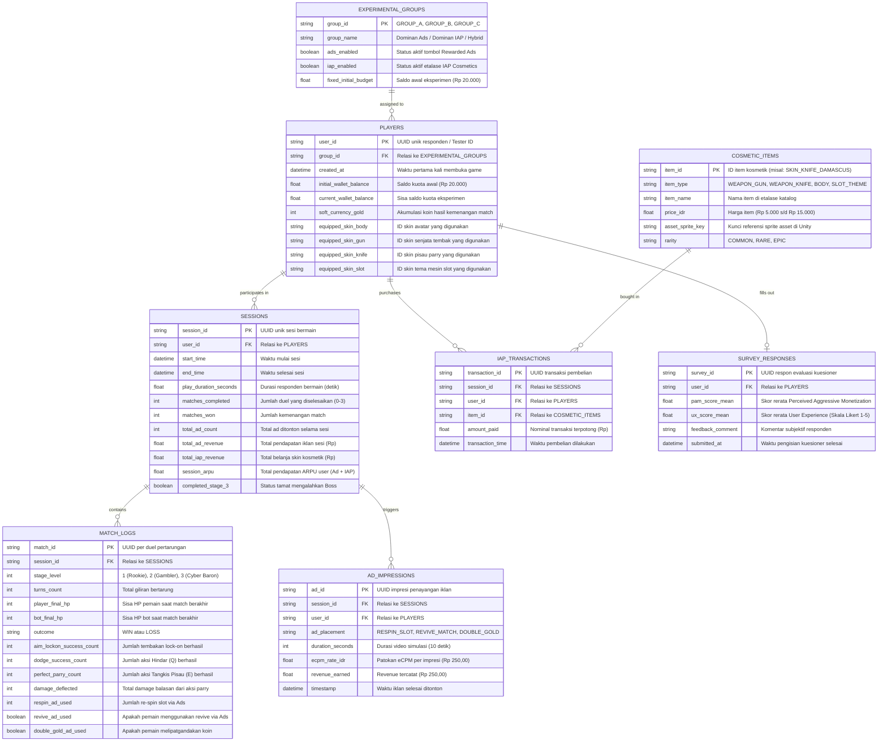

# Entity Relationship Diagram (ERD) & Skema Telemetri Data
**Penelitian**: Komparasi Efektivitas Monetisasi Rewarded Ads dan In-App Purchase (Premium Cosmetics) pada Desain Game Hybrid-Casual Berdasarkan Analisis ARPU  
**Game**: *Lucky Duelist: Cyber Roulette (1v1 Hybrid-Casual RNG Slot with Action Timing)*  
**Peneliti**: Hafiz Ahmad Fauzi / 5224600067  

---

## 1. Konsep Pemodelan Data

Struktur data prototipe dirancang untuk memenuhi dua kebutuhan utama penelitian:
1. **Model Relasional (RDBMS Normalized)**: Digunakan untuk struktur database analitik, kamus data yang terstandarisasi, dan kemudahan ekspor ke file CSV/Excel untuk uji hipotesis statistik (*One-Way ANOVA* / $t$-test).
2. **Model Dokumen NoSQL (Firebase Firestore / Supabase REST)**: Digunakan oleh Unity Client untuk mengirimkan log sesi terpadu (*unified session payload*) secara *real-time* via HTTP POST.

---

## 2. Entity Relationship Diagram (Mermaid)



---

## 3. Kamus Data Kolom Terpilih

### A. Tabel `PLAYERS`
| Nama Kolom | Tipe Data | Keterangan & Validasi |
|---|---|---|
| `user_id` | VARCHAR(36) [PK] | UUID otomatis atau kode tester (misal: `R001-C`). |
| `group_id` | VARCHAR(10) [FK] | Referensi ke kelompok: `'GROUP_A'`, `'GROUP_B'`, `'GROUP_C'`. |
| `initial_wallet_balance`| DECIMAL(10,2) | Saldo kuota eksperimen awal: `20000.00`. |
| `current_wallet_balance`| DECIMAL(10,2) | Sisa saldo setelah responden membeli skin di toko. |
| `soft_currency_gold` | INT | Koin emas hasil memenangkan duel. |
| `equipped_skin_gun` | VARCHAR(50) | ID skin senjata tembak aktif. |
| `equipped_skin_knife` | VARCHAR(50) | ID skin pisau parry aktif. |
| `equipped_skin_body` | VARCHAR(50) | ID skin avatar duelis aktif. |
| `equipped_skin_slot` | VARCHAR(50) | ID tema bingkai mesin slot aktif. |

### B. Tabel `MATCH_LOGS` (Statistik Aksi Real-Time)
| Nama Kolom | Tipe Data | Keterangan & Validasi |
|---|---|---|
| `match_id` | VARCHAR(36) [PK] | UUID unik per ronde pertarungan. |
| `session_id` | VARCHAR(36) [FK] | Relasi ke sesi bermain terkait. |
| `stage_level` | INT | Tingkat kesulitan: `1` (Rookie), `2` (Gambler), `3` (Boss). |
| `outcome` | ENUM | `'WIN'` atau `'LOSS'`. |
| `aim_lockon_success_count`| INT | Frekuensi tembakan berhasil (Lock-On 1.0s penuh). |
| `dodge_success_count`| INT | Frekuensi tombol Q (Hindar) ditekan tepat waktu. |
| `perfect_parry_count`| INT | Frekuensi tombol E (Parry Pisau) ditekan tepat di fase kuning. |
| `damage_deflected` | INT | Total akumulasi damage serangan balik dari aksi parry. |
| `respin_ad_used` | INT | Frekuensi re-spin slot reel via Rewarded Ads. |
| `revive_ad_used` | BOOLEAN | Apakah responden menonton iklan untuk hidup kembali. |
| `double_gold_ad_used`| BOOLEAN | Apakah responden menonton iklan untuk menggandakan koin. |

### C. Tabel `COSMETIC_ITEMS`
| Nama Kolom | Tipe Data | Keterangan & Validasi |
|---|---|---|
| `item_id` | VARCHAR(50) [PK] | Kode unik item (misal: `SKIN_KNIFE_DAMASCUS`). |
| `item_type` | ENUM | `'WEAPON_GUN'`, `'WEAPON_KNIFE'`, `'BODY'`, `'SLOT_THEME'`. |
| `item_name` | VARCHAR(100) | Nama display item di katalog toko. |
| `price_idr` | DECIMAL(10,2) | Harga item: `5000.00`, `10000.00`, atau `15000.00`. |
| `asset_sprite_key` | VARCHAR(100) | Kunci string untuk memuat aset sprite di Unity. |

---

## 4. Format Payload Dokumen NoSQL (Firebase Firestore / Supabase)

Data dikirimkan di akhir sesi bermain sebagai satu dokumen terstruktur ke koleksi `telemetry_sessions`:

```json
{
  "user_id": "RES-C-021",
  "group_id": "GROUP_C",
  "device_model": "Xiaomi Redmi Note 12 / Android 13",
  "created_at": "2026-11-01T14:20:00Z",
  "session": {
    "session_id": "a3b9c8e1-7d24-4f89-912a-88f2e411b092",
    "play_duration_sec": 385.2,
    "matches_completed": 3,
    "matches_won": 3,
    "completed_stage_3": true,
    "soft_currency_gold": 500
  },
  "monetization": {
    "initial_budget": 20000.0,
    "remaining_budget": 0.0,
    "total_iap_revenue": 20000.0,
    "purchased_items": [
      {
        "item_id": "SKIN_KNIFE_DAMASCUS",
        "item_type": "WEAPON_KNIFE",
        "price": 10000.0,
        "timestamp": "2026-11-01T14:21:10Z"
      },
      {
        "item_id": "SKIN_GUN_NEON_BLASTER",
        "item_type": "WEAPON_GUN",
        "price": 10000.0,
        "timestamp": "2026-11-01T14:21:40Z"
      }
    ],
    "ad_impressions_count": 3,
    "ad_impressions_breakdown": {
      "respin_slot": 1,
      "revive_match": 1,
      "double_gold": 1
    },
    "total_ad_revenue": 750.0,
    "total_user_arpu": 20750.0
  },
  "combat_performance": {
    "total_aim_shots_fired": 9,
    "total_aim_lockons_successful": 9,
    "total_dodges_successful": 4,
    "total_perfect_parries": 3,
    "total_damage_deflected": 115
  },
  "match_details": [
    {
      "stage": 1,
      "outcome": "WIN",
      "turns": 3,
      "parry_count": 1,
      "dodge_count": 1,
      "ad_respin_count": 0,
      "ad_revive_used": false
    },
    {
      "stage": 2,
      "outcome": "WIN",
      "turns": 5,
      "parry_count": 1,
      "dodge_count": 2,
      "ad_respin_count": 1,
      "ad_revive_used": false
    },
    {
      "stage": 3,
      "outcome": "WIN",
      "turns": 7,
      "parry_count": 1,
      "dodge_count": 1,
      "ad_respin_count": 0,
      "ad_revive_used": true
    }
  ]
}
```

---

## 5. Formula Analisis Data untuk Uji Beda Statistik (ANOVA)

Data telemetri yang terkumpul dari seluruh responden akan diagregasikan berdasarkan perlakuan kelompok:

1. **Rerata ARPU Iklan ($\overline{ARPU}_{Ads}$)**:
   $$\overline{ARPU}_{Ads} = \frac{\sum_{i=1}^{N_g} \text{total\_ad\_revenue}_i}{N_g}$$

2. **Rerata ARPU Belanja Kosmetik IAP ($\overline{ARPU}_{IAP}$)**:
   $$\overline{ARPU}_{IAP} = \frac{\sum_{i=1}^{N_g} \text{total\_iap\_revenue}_i}{N_g}$$

3. **Total Rerata Pendapatan per User ($\overline{ARPU}_{Total}$)**:
   $$\overline{ARPU}_{Total} = \overline{ARPU}_{Ads} + \overline{ARPU}_{IAP}$$

4. **Uji Hipotesis**:
   Menggunakan **One-Way ANOVA** pada tingkat signifikansi $\alpha = 0,05$ untuk menguji hipotesis:
   * $H_0: \mu_{ARPU\_A} = \mu_{ARPU\_B} = \mu_{ARPU\_C}$ (Tidak terdapat perbedaan efektivitas pendapatan antar skema monetisasi).
   * $H_1$: Setidaknya terdapat satu pasang kelompok yang memiliki perbedaan nilai ARPU secara signifikan.
