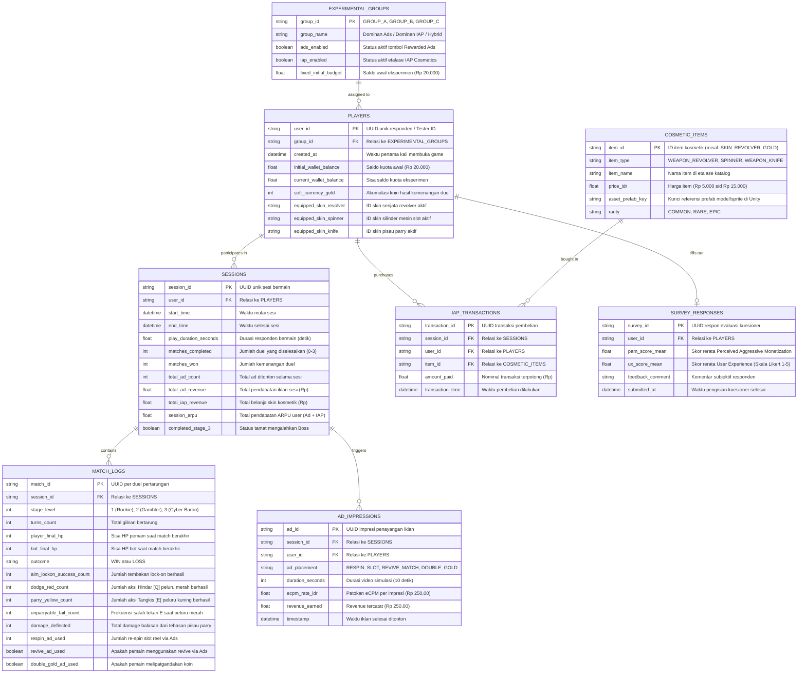

# Entity Relationship Diagram (ERD) & Skema Telemetri Data
**Penelitian**: Komparasi Efektivitas Monetisasi Rewarded Ads dan In-App Purchase (Premium Cosmetics) pada Desain Game Hybrid-Casual Berdasarkan Analisis ARPU  
**Game**: *Lucky Duelist: Cyber Roulette (1v1 First-Person RNG Slot Battler)*  
**Perspektif Kamera**: *Full First-Person View (FPS)*  
**Peneliti**: Hafiz Ahmad Fauzi / 5224600067  

---

## 1. Konsep Pemodelan Data

Struktur data prototipe dirancang untuk merekam perilaku ekonomi pemain (*ARPU*, transaksi *IAP*, dan penayangan *Rewarded Ads*) berdampingan dengan performa refleks sudut pandang orang pertama (*First-Person Combat Stats*):
1. **Model Relasional (RDBMS Normalized)**: Standar integritas data untuk ekspor ke SPSS / Excel / Python guna uji beda statistik (*One-Way ANOVA* / $t$-test).
2. **Model Dokumen NoSQL (Firebase Firestore / Supabase REST)**: Pengiriman payload JSON terintegrasi di akhir sesi bermain secara *real-time*.

---

## 2. Entity Relationship Diagram (Mermaid)



---

## 3. Kamus Data Kolom Terpilih

### A. Tabel `PLAYERS`
| Nama Kolom | Tipe Data | Keterangan & Validasi |
|---|---|---|
| `user_id` | VARCHAR(36) [PK] | UUID otomatis atau kode tester (misal: `R001-C`). |
| `group_id` | VARCHAR(10) [FK] | Referensi ke kelompok: `'GROUP_A'`, `'GROUP_B'`, `'GROUP_C'`. |
| `initial_wallet_balance`| DECIMAL(10,2) | Saldo kuota eksperimen awal: `20000.00`. |
| `current_wallet_balance`| DECIMAL(10,2) | Sisa saldo setelah responden membeli skin di toko. |
| `soft_currency_gold` | INT | Koin emas hasil memenangkan duel. |
| `equipped_skin_revolver`| VARCHAR(50) | ID skin senjata revolver di tangan kanan. |
| `equipped_skin_spinner` | VARCHAR(50) | ID skin silinder 3-reel slot amunisi. |
| `equipped_skin_knife` | VARCHAR(50) | ID skin pisau parry di tangan kiri. |

### B. Tabel `MATCH_LOGS` (Statistik Refleks FPS)
| Nama Kolom | Tipe Data | Keterangan & Validasi |
|---|---|---|
| `match_id` | VARCHAR(36) [PK] | UUID unik per ronde duel. |
| `session_id` | VARCHAR(36) [FK] | Relasi ke sesi bermain terkait. |
| `stage_level` | INT | Tingkat kesulitan: `1` (Rookie), `2` (Gambler), `3` (Boss). |
| `outcome` | ENUM | `'WIN'` atau `'LOSS'`. |
| `aim_lockon_success_count`| INT | Frekuensi tembakan auto-fire lock-on 1,0s berhasil. |
| `dodge_red_count` | INT | Frekuensi sukses menghindar [Q] saat peluru merah musuh meluncur. |
| `parry_yellow_count` | INT | Frekuensi sukses menangkis [E] saat peluru kuning musuh meluncur. |
| `unparryable_fail_count` | INT | Frekuensi salah menekan E saat serangan merah (gagal parry). |
| `damage_deflected` | INT | Total damage balasan ke bot dari aksi parry pisau. |
| `respin_ad_used` | INT | Frekuensi re-spin silinder revolver via Rewarded Ads. |
| `revive_ad_used` | BOOLEAN | Apakah responden menonton iklan untuk hidup kembali. |
| `double_gold_ad_used`| BOOLEAN | Apakah responden menonton iklan untuk menggandakan koin. |

### C. Tabel `COSMETIC_ITEMS` (Katalog Skin First-Person)
| Nama Kolom | Tipe Data | Keterangan & Validasi |
|---|---|---|
| `item_id` | VARCHAR(50) [PK] | Kode unik item (misal: `SKIN_REVOLVER_GOLD`). |
| `item_type` | ENUM | `'WEAPON_REVOLVER'`, `'SPINNER'`, `'WEAPON_KNIFE'`. |
| `item_name` | VARCHAR(100) | Nama display item di katalog toko. |
| `price_idr` | DECIMAL(10,2) | Harga item: `5000.00`, `10000.00`, atau `15000.00`. |
| `asset_prefab_key` | VARCHAR(100) | Kunci string untuk memuat aset model/material di Unity. |

---

## 4. Format Payload Dokumen NoSQL (Firebase Firestore / Supabase)

Dokumen dikirimkan pada akhir sesi ke collection `telemetry_sessions`:

```json
{
  "user_id": "RES-C-029",
  "group_id": "GROUP_C",
  "device_model": "Xiaomi Redmi Note 12 / Android 13",
  "created_at": "2026-11-01T17:10:00Z",
  "session": {
    "session_id": "c1f7b942-8e12-42da-921a-99d8e411b033",
    "play_duration_sec": 395.4,
    "matches_completed": 3,
    "matches_won": 3,
    "completed_stage_3": true,
    "soft_currency_gold": 550
  },
  "monetization": {
    "initial_budget": 20000.0,
    "remaining_budget": 0.0,
    "total_iap_revenue": 20000.0,
    "purchased_items": [
      {
        "item_id": "SKIN_REVOLVER_DAMASCUS",
        "item_type": "WEAPON_REVOLVER",
        "price": 10000.0,
        "timestamp": "2026-11-01T17:11:15Z"
      },
      {
        "item_id": "SKIN_KNIFE_TANTO",
        "item_type": "WEAPON_KNIFE",
        "price": 10000.0,
        "timestamp": "2026-11-01T17:11:40Z"
      }
    ],
    "ad_impressions_count": 3,
    "ad_impressions_breakdown": {
      "respin_slot": 1,
      "revive_match": 1,
      "double_gold": 1
    },
    "total_ad_revenue": 750.0,
    "total_user_arpu": 20750.0
  },
  "fps_combat_performance": {
    "total_aim_shots_fired": 11,
    "total_aim_lockons_successful": 11,
    "total_red_bullets_dodged": 4,
    "total_yellow_bullets_parried": 3,
    "total_unparryable_fails": 1,
    "total_damage_deflected": 120
  },
  "match_details": [
    {
      "stage": 1,
      "outcome": "WIN",
      "turns": 3,
      "parry_count": 1,
      "dodge_count": 1,
      "unparryable_fails": 0,
      "ad_respin_count": 0,
      "ad_revive_used": false
    },
    {
      "stage": 2,
      "outcome": "WIN",
      "turns": 5,
      "parry_count": 1,
      "dodge_count": 2,
      "unparryable_fails": 1,
      "ad_respin_count": 1,
      "ad_revive_used": false
    },
    {
      "stage": 3,
      "outcome": "WIN",
      "turns": 7,
      "parry_count": 1,
      "dodge_count": 1,
      "unparryable_fails": 0,
      "ad_respin_count": 0,
      "ad_revive_used": true
    }
  ]
}
```

---

## 5. Formula Analisis Data untuk Uji Beda Statistik (ANOVA)

Data telemetri yang terkumpul dari seluruh responden akan diagregasikan berdasarkan perlakuan kelompok:

1. **Rerata ARPU Iklan ($\overline{ARPU}_{Ads}$)**:
   $$\overline{ARPU}_{Ads} = \frac{\sum_{i=1}^{N_g} \text{total\_ad\_revenue}_i}{N_g}$$

2. **Rerata ARPU Belanja Kosmetik IAP ($\overline{ARPU}_{IAP}$)**:
   $$\overline{ARPU}_{IAP} = \frac{\sum_{i=1}^{N_g} \text{total\_iap\_revenue}_i}{N_g}$$

3. **Total Rerata Pendapatan per User ($\overline{ARPU}_{Total}$)**:
   $$\overline{ARPU}_{Total} = \overline{ARPU}_{Ads} + \overline{ARPU}_{IAP}$$

4. **Uji Hipotesis**:
   Menggunakan **One-Way ANOVA** pada tingkat signifikansi $\alpha = 0,05$ untuk menguji signifikansi perbedaan antara Kelompok A, B, dan C.
