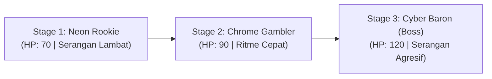

# Game Design Document (GDD)
**Judul Game**: *Lucky Duelist: Cyber Roulette*  
**Genre**: *Hybrid-Casual 1v1 Turn-Based RNG Slot Battler with Real-Time Action Timing*  
**Platform**: Android (Mobile) & PC  
**Peneliti / Desainer**: Hafiz Ahmad Fauzi / 5224600067  
**Fokus Penelitian**: Komparasi Efektivitas Monetisasi Rewarded Ads vs In-App Purchase (Premium Cosmetics) Berdasarkan Analisis ARPU (Average Revenue Per User)  

---

## 1. Visi Game & Konsep Utama (High Concept)

### 1.1. Ringkasan Eksekutif
*Lucky Duelist: Cyber Roulette* adalah game duel taktis berkecepatan tinggi yang memadukan keseruan mesin keberuntungan (*3-Reel Slot Machine*) dengan eksekusi refleks *real-time* (*Aiming Mini-Game* saat menyerang dan *Dodge/Parry Timing* saat bertahan). Karakter kedua duelis berdiri berhadapan dalam arena kasino futuristik bergaya *Dark Cyberpunk Neon*. 

Pemain mengundi aksi melalui mesin slot 3 gulungan, dapat menimbun simbol di **2 Slot Cadangan (Hold Inventory)** untuk kombo, membidik titik vital musuh menggunakan mekanik *counter-drag*, serta menangkis tebasan musuh menggunakan pisau secara presisi (*parry*).

Prototipe ini dirancang seringkas mungkin (3 stage beruntun, durasi total 5–7 menit) untuk keperluan penelitian komparasi efektivitas skema monetisasi *Rewarded Ads* dan *IAP Premium Cosmetics*.

```
┌────────────────────────────────────────────────────────────────────────┐
│                               CORE LOOP                                │
│                                                                        │
│    ┌──────────────┐     ┌──────────────┐     ┌──────────────────┐      │
│    │  Kunjungi    │ ──► │  Pilih Stage │ ──► │ Putar Mesin Slot │      │
│    │  Toko Skin   │     │  (1 s/d 3)   │     │   (3-Reel RNG)   │      │
│    └──────────────┘     └──────────────┘     └────────┬─────────┘      │
│           ▲                                           │                │
│           │                                           ▼                │
│    ┌──────┴───────┐     ┌──────────────┐     ┌──────────────────┐      │
│    │ Koin Menang  │ ◄── │ Fase Bertahan│ ◄── │  Fase Menyerang  │      │
│    │(Double via Ad│     │ (Dodge/Parry)│     │  (Aim Stabilizer)│      │
│    └──────────────┘     └──────────────┘     └──────────────────┘      │
└────────────────────────────────────────────────────────────────────────┘
```

---

## 2. Mekanika Gameplay Inti (Core Mechanics)

### 2.1. Parameter Pertarungan
* **Player HP**: 100 / 100.
* **Kondisi Menang**: Menghabisi HP musuh hingga 0.
* **Kondisi Kalah**: HP pemain menyentuh 0 (memunculkan opsi *Second-Chance Revive via Rewarded Ad* bagi kelompok A dan C).

---

### 2.2. Komposisi Simbol Mesin Slot (3-Reel Deck)
Setiap giliran (*turn*), 3 gulungan berputar menghasilkan kombinasi simbol dari 5 jenis kartu aksi:

| Simbol | Ikon | Peluang | Peran & Efek Mekanis |
|---|---|---|---|
| **ATTACK** | ⚔️ Peluru / Blaster | 35% | Memberikan amunisi tembakan aktif. Memicu mini-game *Aim Stabilizer*. |
| **MARK** | 🎯 Target Reticle | 20% | Menandai titik lemah musuh; melipatgandakan *Critical Damage* tembakan (2x lipat) dan memperbesar lingkaran vital. |
| **HEAL** | 💉 Nano-Medkit | 20% | Menyuntikkan pemulihan langsung sebesar +20 HP ke pemain. |
| **COUNTER / SHARPEN** | 🗡️ Asah Pisau | 15% | Mengasah pisau parry; memunculkan *Audio Cue Warning* sebelum musuh menyerang dan menambah *True Damage* balasan saat parry sukses. |
| **WILD / JOKER** | ⭐ Bintang Kasino | 10% | Kartu langka (Rare). Berfungsi sebagai *Wildcard* yang dapat diubah pemain menjadi simbol apa pun yang diinginkan. |

> **Catatan Desain**: Simbol pasif *Shield* dan simbol hukuman *Jam* resmi ditiadakan untuk menjaga tempo permainan yang adiktif dan memastikan setiap putaran memberi kendali aksi penuh ke pemain.

---

### 2.3. Sistem Taktis: 2 Slot Cadangan (Hold Inventory)
Pemain memiliki fleksibilitas taktis dalam mengalokasikan hasil putaran:
1. Pemain dapat menyimpan maksimal **2 simbol** ke dalam **Kotak Cadangan (Hold Slots)** untuk disimpan ke giliran berikutnya.
2. Minimal **1 simbol** harus dieksekusi pada giliran aktif.
3. Simbol di *Hold Slots* dapat ditarik kembali pada giliran berikutnya untuk membentuk kombo (misal: mengumpulkan *Mark* + 2x *Attack*).

---

### 2.4. Fase Menyerang: Aim Stabilizer & Auto-Fire Lock-On
Ketika simbol `[ATTACK]` dieksekusi, kamera beralih ke mode bidik di atas tubuh musuh:

```
┌────────────────────────────────────────────────────────┐
│              [KOTAK BIDIK LUAR (AREA TUBUH)]           │
│                                                        │
│             ┌──────────────────────┐                   │
│             │   [LINGKARAN VITAL]  │                   │
│             │    (Kepala/Jantung)  │                   │
│             │        [ 🎯 ]        │                   │
│             └──────────────────────┘                   │
│                                                        │
│                  ↗ [Drift Liar]                        │
│             (+) Reticle                                │
│              │                                         │
│              ▼ [Counter-Drag Pemain]                   │
│                                                        │
│   PROGRESS LOCK-ON: [██████████░░░░] 65% (1.0 Detik)   │
└────────────────────────────────────────────────────────┘
```

1. **Struktur Area Bidik**:
   * **Kotak Luar**: Area luas mencakup kepala dan badan musuh.
   * **Lingkaran Vital (*Sweet Spot*)**: Lingkaran target presisi yang terletak di area vital (kepala atau jantung).
2. **Kontrol *Counter-Drag***:
   * Reticle bidik bergerak meluncur secara acak (*drift*) oleh sistem.
   * Pemain melakukan *counter-drag* (menyeret ke arah sebaliknya) untuk mengarahkan dan menstabilkan reticle ke dalam lingkaran vital.
3. **Mekanisme *Auto-Fire Lock-On***:
   * Selama reticle berhasil ditahan di dalam lingkaran vital, meteran *Lock-On* akan terisi (0% menuju 100% dalam waktu **1,0 detik**).
   * Begitu meteran mencapai 100%, senjata **otomatis menembak** dengan akurasi sempurna tanpa perlu tombol terpisah.
4. **Kombo Beruntun (*Multi-Attack Chaining*)**:
   * Jika pemain mengeksekusi kombo 2x atau 3x `[ATTACK]`, setelah tembakan pertama meletus, meteran langsung berlanjut mengisi *Lock-On* berikutnya secara beruntun (*rapid burst shots*).
   * Jika musuh memiliki status `[MARK]`, tembakan yang mendarat menghasilkan *Critical Hit* dengan efek visual ledakan neon.

---

### 2.5. Fase Bertahan: Hindar (Dodge) & Tangkis Pisau (Parry)
Saat giliran musuh menyerang, pemain tidak pasif. Sistem menyajikan tes refleks interaktif dengan visual telegraf cahaya:

```
                  WAKTU SERANGAN MUSUH (TIMELINE)
0.0s ──────────────────────── 0.6s ──────────── 0.8s ── 1.0s (Hit!)
 [Cahaya Transparan -> Merah]   [Cahaya Kuning]
        ZONA HINDAR (Q)         ZONA PARRY (E)
```

1. **Kontrol Pertahanan**:
   * Tombol **"Q"** (atau tombol UI kiri di mobile): **HINDAR (DODGE)**.
   * Tombol **"E"** (atau tombol UI kanan di mobile): **TANGKIS PISAU (PARRY)**.
2. **Indikator Visual & Timing**:
   * **Fase Cahaya Merah (Timing Lebar: ~0.6 s/d 0.8 detik)**:
     * Menekan **"Q"**: Karakter melakukan roll/geser ke samping. Menghindari seluruh serangan (**Damage = 0**).
   * **Fase Cahaya Kuning (Timing Presisi: ~0.2 s/d 0.3 detik tepat sebelum serangan mendarat)**:
     * Menekan **"E"**: Karakter menangkis tebasan musuh dengan pisau.
     * Memicu efek suara lentingan logam (*'CLANG!'*) dan kilatan percikan neon.
     * Membatalkan serangan musuh (**Damage Pemain = 0**) dan langsung membalikkan serangan (*Deflection Riposte*) dengan tebasan pisau berpotensi *Critical Damage* (35–45 Damage ke musuh!).
3. **Sinergi Slot `[COUNTER / SHARPEN]`**:
   * Jika pemain memiliki buff asah pisau aktif, sistem akan memainkan **Audio Cue Peringatan** khas beberapa saat sebelum musuh mengayunkan serangan, mempermudah pemain mengantisipasi timing emas Parry serta menambahkan *true damage* ekstra pada tebasan balasan.

---

## 3. Desain Musuh & Skalabilitas Level (Progression)

Satu sesi pengujian terdiri dari 3 duel bertingkat dengan durasi total ~5–7 menit:



1. **Stage 1: Neon Rookie (Pemanasan)**:
   * HP: 70.
   * Karakteristik: Kecepatan serangan lambat (fase cahaya merah panjang 1.0 detik), memudahkan pemain melatih refleks Hindar (Q).
2. **Stage 2: Chrome Gambler (Tantangan Menengah)**:
   * HP: 90.
   * Karakteristik: Ritme serangan bervariasi; memiliki jeda palsu sebelum tebasan kuning mendarat untuk menguji ketepatan Parry (E).
3. **Stage 3: The Cyber Baron - Final Boss (Klimaks Pertarungan)**:
   * HP: 120.
   * Karakteristik: Serangan berkecepatan tinggi dan pukulan beruntun; mengharuskan pemain mengombinasikan *Counter/Sharpen*, *Mark*, dan Parry presisi demi membalikkan keadaan.

---

## 4. Desain Monetisasi & Matriks Skenario A/B/C

### 4.1. Titik Penempatan Rewarded Ads
Iklan berhadiah (*Rewarded Ads*) ditempatkan pada momen kritis yang memiliki nilai utilitas tinggi bagi pemain:
1. **Tactical Re-spin Slot Reel**:
   * *Trigger*: Saat salah satu reel menghasilkan simbol yang tidak diinginkan (misal butuh Attack tapi keluar Heal saat HP penuh).
   * *Reward*: Memutar ulang 1 reel pilihan pemain.
   * *Limit*: Maksimal 1x per giliran.
2. **Second-Chance Revive**:
   * *Trigger*: Saat pemain gagal melakukan parry/dodge dan HP menyentuh angka 0.
   * *Reward*: Hidup kembali dengan 50% HP dan melanjutkan duel tanpa kehilangan progres stage.
   * *Limit*: Maksimal 1x per match.
3. **Double Gold Multiplier**:
   * *Trigger*: Di layar kemenangan setelah menumbangkan musuh.
   * *Reward*: Melipatgandakan koin emas yang didapatkan (misal: 150 Gold menjadi 300 Gold).

### 4.2. Katalog IAP Premium Cosmetics (Non Pay-to-Win)
Seluruh item di toko bersifat estetika murni tanpa memodifikasi status HP atau damage dasar:
1. **Skin Senjata Tembak (Blaster / Revolver)**:
   * *Neon Plasma Blaster* (Rp 10.000): Mengubah reticle aim menjadi segitiga laser ungu dan suara tembakan plasma sci-fi.
   * *High-Roller Gold Revolver* (Rp 15.000): Bingkai emas berkilau, reticle bidik emas, dan suara denting koin saat Lock-On 100%.
2. **Skin Pisau Parry (Combat Knife / Dagger)**:
   * *Cyber Damascus Blade* (Rp 10.000): Pisau futuristik berpola neon; mengubah efek tangkisan 'CLANG!' menjadi percikan partikel cyan.
   * *Viper Serrated Knife* (Rp 15.000): Pisau bergerigi hitam legam; memberikan efek tebasan beracun hijau neon saat melakukan serangan balik parry.
3. **Skin Karakter / Avatar Body**:
   * *Neon Ronin* (Rp 10.000): Jubah cyberpunk bercahaya; animasi roll hindar (dodge) meninggalkan jejak siluet bayangan (*motion blur*).
   * *Syndicate Enforcer* (Rp 15.000): Jas taktis titanium dengan sarung tangan krom.
4. **Skin Tema Mesin Slot**:
   * *Retro Arcade 1984* (Rp 5.000): Bingkai mesin slot tabung CRT jadul.
   * *Golden Casino Deluxe* (Rp 10.000): Bingkai kasino mewah berbalut beludru merah.

### 4.3. Matriks Skenario A/B/C Testing
| Parameter Eksperimen | Kelompok A (Dominan Ads) | Kelompok B (Dominan IAP) | Kelompok C (Skema Hibrida) |
|---|---|---|---|
| **Akses Toko Skin IAP** | **DITUTUP** (Menu Disembunyikan) | **DIBUKA** (Saldo Kuota Rp 20.000) | **DIBUKA** (Saldo Kuota Rp 20.000) |
| **Tombol Re-spin Ads** | **AKTIF** | **NONAKTIF** (Hidden) | **AKTIF** |
| **Tombol Revive Ads** | **AKTIF** | **NONAKTIF** (Langsung Game Over) | **AKTIF** |
| **Tombol 2x Gold Ads** | **AKTIF** | **NONAKTIF** (Klaim Normal) | **AKTIF** |
| **Kontribusi Metrik ARPU** | Murni Pendapatan eCPM Iklan | Murni Pembelian Skin Toko | Akumulasi Iklan + Belanja Skin |

---

## 5. Tata Letak Antarmuka & Wireframe UX

### 5.1. Tampilan Layar Pertarungan (Combat Screen)
```
┌─────────────────────────────────────────────────────────────┐
│ [PAUSE]   PLAYER: Hafiz [Group C]           BOT: Cyber Baron│
│           HP: [██████████░░] 80/100         HP: [██████████]│
│                                                             │
│       ┌───────────────┐             ┌───────────────┐       │
│       │ PLAYER AVATAR │     VS      │  ENEMY AVATAR │       │
│       │ [Equipped Skin│             │ [Boss Visual] │       │
│       │  & Knife Skin]│             │               │       │
│       └───────────────┘             └───────────────┘       │
│                                                             │
│ ══════════════════════ [MESIN SLOT] ═══════════════════════ │
│   ┌───────────────┐  ┌───────────────┐  ┌───────────────┐   │
│   │   [REEL 1]    │  │   [REEL 2]    │  │   [REEL 3]    │   │
│   │    ATTACK     │  │     MARK      │  │COUNTER/SHARPEN│   │
│   │   (⚔️ Tembak)  │  │  (🎯 2x Crit) │  │  (🗡️ Asah Pisau│   │
│   └───────┬───────┘  └───────┬───────┘  └───────┬───────┘   │
│           │ [Re-spin Ad]     │ [Re-spin Ad]     │ [Re-spin] │
│                                                             │
│ ────────────────── [HOLD SLOTS (MAKS 2)] ────────────────── │
│   [ SLOT HOLD 1: (HEAL 💉) ]      [ SLOT HOLD 2: (KOSONG) ] │
│                                                             │
│ ── [KONTROL AKSI PERTAHANAN] ────────────────────────────── │
│       [ Q: HINDAR (DODGE) ]         [ E: PARRY PISAU ]      │
└─────────────────────────────────────────────────────────────┘
```

---

## 6. Alur Pasca-Sesi & Kuesioner Evaluasi

Setelah responden menyelesaikan Stage 3 (atau gugur di Stage 2/3):
1. **Layar Settlement**: Menampilkan ringkasan skor, koin emas, dan status kemenangan.
2. **Unggah Telemetri Latar Belakang**: Unity Client otomatis mengirimkan data performa, impresi iklan, dan transaksi belanja ke Cloud Database.
3. **Integrasi Google Form**: Tombol *"Lanjut ke Kuesioner Evaluasi"* membuka browser menuju kuesioner evaluasi *Perceived Aggressive Monetization* (PAM) dan kepuasan UX dengan parameter URL prefilled:
   `https://forms.gle/xyz...?entry.111={USER_ID}&entry.222={GROUP_ID}`
