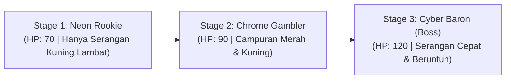

# Game Design Document (GDD)
**Judul Game**: *Lucky Duelist: Cyber Roulette*  
**Genre**: *Hybrid-Casual 1v1 First-Person RNG Slot Battler with Action Timing*  
**Perspektif Kamera**: *Full First-Person View (FPS)*  
**Platform**: Android (Mobile) & PC  
**Peneliti / Desainer**: Hafiz Ahmad Fauzi / 5224600067  
**Fokus Penelitian**: Komparasi Efektivitas Monetisasi Rewarded Ads vs In-App Purchase (Premium Cosmetics) Berdasarkan Analisis ARPU  

---

## 1. Visi Game & Perspektif First-Person (High Concept)

### 1.1. Ringkasan Eksekutif
*Lucky Duelist: Cyber Roulette* adalah game aksi duel 1v1 berkecepatan tinggi dari **sudut pandang orang pertama (First-Person / FPS)**. Layar adalah mata pemain:
* **Tangan Kanan**: Memegang **Revolver Taktis** di mana silinder amunisinya berupa **Mesin Slot 3-Reel (*Diegetic Slot Spinner*)** yang berputar setiap giliran.
* **Tangan Kiri**: Memegang **Pisau Tempur (*Parry Knife*)** yang siap diangkat ke tengah layar untuk menangkis peluru lawan.
* **Musuh di Depan**: Berdiri di seberang ruangan/arena kasino cyberpunk, membidikkan pistol langsung ke arah kamera pemain.

Game ini memadukan sensasi undian kasino kasual (*slot machine roll & hold*) dengan refleks mikro *first-person*:
1. **Fase Menyerang**: Membidik kotak target melayang di atas tubuh musuh, menahan goyangan reticle (*counter-drag*) selama 1 detik hingga *Lock-On* 100%, lalu melepaskan tembakan otomatis.
2. **Fase Bertahan**: Mengantisipasi tembakan pistol musuh. Menghindari peluru merah tak tertangkis dengan **[Q] Hindar** (kamera tersentak/miring ke samping) atau menebas peluru kuning dengan **[E] Tangkis Pisau** (percikan 'CLANG!' yang membalikkan proyektil ke musuh).

```
┌────────────────────────────────────────────────────────────────────────┐
│                        CORE LOOP (FIRST-PERSON)                        │
│                                                                        │
│    ┌──────────────┐     ┌──────────────┐     ┌──────────────────┐      │
│    │  Kunjungi    │ ──► │  Pilih Stage │ ──► │ Putar Silinder   │      │
│    │  Toko Skin   │     │  (1 s/d 3)   │     │ (Slot Revolver)  │      │
│    └──────────────┘     └──────────────┘     └────────┬─────────┘      │
│           ▲                                           │                │
│           │                                           ▼                │
│    ┌──────┴───────┐     ┌──────────────┐     ┌──────────────────┐      │
│    │ Koin Menang  │ ◄── │ Fase Bertahan│ ◄── │  Fase Menyerang  │      │
│    │(Double via Ad│     │ (Dodge/Parry)│     │(FPS Aim Lock-On) │      │
│    └──────────────┘     └──────────────┘     └──────────────────┘      │
└────────────────────────────────────────────────────────────────────────┘
```

---

## 2. Mekanika Gameplay Inti (Core Mechanics)

### 2.1. Parameter Pertarungan
* **Player HP**: 100 / 100.
* **Kondisi Menang**: Menghabisi HP musuh di hadapan pemain hingga 0.
* **Kondisi Kalah**: HP pemain mencapai 0 (memicu penawaran *Second-Chance Revive via Rewarded Ad* pada Group A dan C).

---

### 2.2. Komposisi 5 Simbol Silinder Revolver (Slot Deck)
Setiap giliran, silinder revolver berputar mengacak 3 simbol aksi:

| Simbol | Ikon | Peluang | Efek & Peran Mekanis |
|---|---|---|---|
| **ATTACK** | ⚔️ Peluru Blaster | 35% | Mengisi peluru aktif; memicu fase bidik FPS (*Aim Stabilizer*). |
| **MARK** | 🎯 Target Reticle | 20% | Menandai tubuh musuh; memperbesar lingkaran vital dan melipatgandakan *Critical Damage* tembakan (2x lipat). |
| **HEAL** | 💉 Nano-Medkit | 20% | Pemulihan instan +20 HP ke pemain. |
| **COUNTER / SHARPEN** | 🗡️ Asah Pisau | 15% | Mengasah pisau parry; memunculkan *Audio Cue Warning* ("Ching-Ching / Kokangan Senjata") sebelum musuh menembak dan menambah *True Damage* saat parry sukses. |
| **WILD / JOKER** | ⭐ Bintang Kasino | 10% | Kartu langka (Rare); pemain bebas memilih simbol pengganti apa pun. |

---

### 2.3. Sistem 2 Slot Cadangan (Hold Inventory)
Terletak pada HUD minimalis di pojok kiri bawah:
1. Pemain dapat menyimpan maksimal **2 simbol** ke kotak cadangan untuk disimpan ke giliran berikutnya.
2. Minimal **1 simbol** harus dieksekusi pada giliran aktif.
3. Simbol cadangan dapat ditarik kembali untuk membentuk kombo beruntun (misal: menimbun 2x atau 3x *Attack*).

---

### 2.4. Fase Menyerang: FPS Aim Stabilizer & Auto-Fire Lock-On
Saat simbol `[ATTACK]` aktif, kamera memfokuskan bidikan ke musuh:

```
┌─────────────────────────────────────────────────────────────┐
│ [PAUSE]                                                     │
│                                                             │
│             ┌──────────────────────┐                        │
│             │   [KOTAK TARGET]     │                        │
│             │   ┌──────────────┐   │                        │
│             │   │(Lingkaran O) │   │                        │
│             │   └──────────────┘   │                        │
│             └──────────────────────┘                        │
│                                                             │
│                   (+) Reticle [Drift]                       │
│                        │ [Counter-Drag]                     │
│                        ▼                                    │
│                                                             │
│                                      [REVOLVER DENGAN]      │
│ [HUD KIRI BAWAH]                     [3-REEL SPINNER ]      │
│ HP: [████████░░] 80/100              [DI SILINDER SENJATA]  │
│ HOLD: [🗡️][  ]                       (Tangan Kanan)         │
│ LOCK-ON: [██████████] 100% (AUTO-FIRE!)                     │
└─────────────────────────────────────────────────────────────┘
```

1. **Kotak Target & Lingkaran Vital**:
   * Sebuah kotak target mengambang di atas tubuh musuh (seperti referensi luk4dev).
   * Di dalam kotak, terdapat **Lingkaran Vital (*Sweet Spot*)** di area kepala atau jantung.
2. **Kontrol *Counter-Drag***:
   * Reticle bidik bergerak meluncur liar secara acak (*Perlin noise drift*).
   * Pemain menggeser/drag mouse atau layar sentuh ke arah berlawanan untuk mengarahkan reticle ke dalam lingkaran vital.
3. **Mekanisme *Auto-Fire Lock-On (1,0 Detik)***:
   * Menahan reticle di dalam lingkaran vital mengisi meteran *Lock-On* (0% $\rightarrow$ 100% dalam 1,0 detik).
   * Begitu mencapai 100%, revolver **otomatis meletuskan tembakan** dengan akurasi sempurna!
   * Jika pemain memiliki kombo 2x/3x *Attack*, tembakan pertama langsung disusul pengisian *lock-on* berikutnya secara beruntun (*rapid burst*).
   * Jika musuh terkena status `[MARK]`, tembakan yang meletus menghasilkan *Critical Damage* masif.

---

### 2.5. Fase Bertahan: Hindar (Q) & Tangkis Pisau (E) vs Pistol Musuh
Semua musuh menyerang menggunakan pistol. Moncong senjata musuh memancarkan telegraf cahaya yang membedakan jenis serangan:

```
                  SKEMA SERANGAN MUSUH DARI PERSPEKTIF FPS
                  
1. SERANGAN MERAH (UNPARRYABLE - TIDAK BISA DITANGKIS)
   [Moncong Cahaya Merah] ──► [Peluru Tracer Merah Meluncur]
   • WAJIB TEKAN [Q]: Kamera tersentak/sway ke samping -> Peluru lewat ('WHEW!'), 0 Damage.
   • JIKA TEKAN [E]: Pisau gagal menahan -> Kena Damage Penuh!

2. SERANGAN KUNING (PARRYABLE / CRITICAL - BISA DITANGKIS)
   [Moncong Kilatan Kuning] ──► [Peluru Tracer Kuning Meluncur]
   • TEKAN [E] PRESISI (~0.2-0.3s): Tangan kiri mengayunkan pisau ke tengah layar!
     -> SFX 'CLANG!' + Percikan Bunga Api Neon!
     -> Peluru berbalik menghantam musuh dengan CRITICAL DAMAGE!
   • TEKAN [Q]: Karakter tetap bisa menghindar ke samping (pilihan lebih aman, 0 Damage).
```

* **Sinergi Slot `[COUNTER / SHARPEN]`**:
  Jika pemain mengaktifkan buff asah pisau, sistem akan memutar **Audio Cue Warning** khas (*"Ching-Ching / Kokangan Senjata"*) beberapa detik sebelum musuh menarik pelatuk, memberi pemain tanda siap melakukan parry serta meningkatkan damage pantulan peluru!

---

## 3. Desain Musuh & Skalabilitas Level (Progression)

Sesi pengujian terdiri dari 3 duel berurutan dari sudut pandang FPS:



1. **Stage 1: Neon Rookie (Pemanasan)**:
   * HP: 70.
   * Serangan: 100% serangan kuning bertempo lambat. Membantu responden terbiasa dengan sensasi menangkis peluru dengan pisau [E].
2. **Stage 2: Chrome Gambler (Tantangan Menengah)**:
   * HP: 90.
   * Serangan: Mengombinasikan serangan merah (wajib Q) dan serangan kuning (bisa E). Memaksa responden membaca warna telegraf moncong pistol.
3. **Stage 3: The Cyber Baron - Final Boss (Klimaks Pertarungan)**:
   * HP: 120.
   * Serangan: Tembakan cepat beruntun (misal: tembakan merah disusul tembakan kuning kilat). Menguji integrasi taktis slot `[COUNTER]` dan `[MARK]`.

---

## 4. Desain Monetisasi & Matriks Skenario A/B/C

### 4.1. Titik Penempatan Rewarded Ads
1. **Tactical Re-spin Slot Reel**: Mengulang putaran 1 reel di silinder revolver jika hasilnya buruk (maksimal 1x per turn).
2. **Second-Chance Revive**: Bangkit kembali dengan 50% HP saat tertembak mati di stage sengit (maksimal 1x per match).
3. **Double Gold Multiplier**: Menggandakan perolehan koin emas kemenangan di akhir duel.

### 4.2. Katalog IAP Premium Cosmetics (First-Person Optimized)
Karena sudut pandang game adalah First-Person, katalog kosmetik dirancang pada objek yang **100% tampak jelas di layar pemain**:
1. **Skin Senjata (Revolver Skin)**:
   * *Cyber Damascus Revolver* (Rp 10.000): Ukiran sirkuit bercahaya, reticle plasma ungu, dan suara tembakan railgun.
   * *High-Roller Gold Revolver* (Rp 15.000): Bingkai emas murni, kilauan cahaya saat lock-on, dan suara denting koin emas saat peluru meletus.
2. **Skin Spinner (Slot Cylinder Skin)**:
   * *Neon Casino Reels* (Rp 5.000): Desain gulungan slot holografis pada silinder senjata dengan efek lampu jackpot.
   * *Retro Arcade 1984 Spinner* (Rp 5.000): Silinder bertema arcade jadul dengan font piksel menyala.
3. **Skin Pisau Parry (Knife Skin)**:
   * *Cyber Tantō Knife* (Rp 10.000): Pisau belati bergaya samurai modern; percikan tangkisan 'CLANG!' berwarna cyan neon.
   * *Viper Serrated Dagger* (Rp 15.000): Pisau bergerigi hitam legam; memberikan kilatan hijau beracun saat memantulkan peluru.

### 4.3. Matriks Skenario A/B/C Testing
| Parameter Eksperimen | Kelompok A (Dominan Ads) | Kelompok B (Dominan IAP) | Kelompok C (Skema Hibrida) |
|---|---|---|---|
| **Akses Toko Skin IAP** | **DITUTUP** (Menu Hidden) | **DIBUKA** (Saldo Rp 20.000) | **DIBUKA** (Saldo Rp 20.000) |
| **Katalog Skin** | - | Skin Revolver, Spinner, Pisau | Skin Revolver, Spinner, Pisau |
| **Tombol Re-spin Ads** | **AKTIF** | **NONAKTIF** (Hidden) | **AKTIF** |
| **Tombol Revive Ads** | **AKTIF** | **NONAKTIF** (Langsung Kalah) | **AKTIF** |
| **Tombol 2x Gold Ads** | **AKTIF** | **NONAKTIF** (Klaim Normal) | **AKTIF** |
| **Perhitungan ARPU** | $ARPU = \sum \text{Ad Revenue}$ | $ARPU = \sum \text{IAP Spent}$ | $ARPU = \text{Ad Rev} + \text{IAP Spent}$ |

---

## 5. Tata Letak Antarmuka (HUD Layout)

Sesuai preferensi terpilih, layar First-Person menggunakan tata letak **HUD Minimalis di Pojok Bawah Kiri**:

```
┌─────────────────────────────────────────────────────────────┐
│ [PAUSE]                                                     │
│                                                             │
│                   ┌──────────────────┐                      │
│                   │   KOTAK TARGET   │                      │
│                   │      [ 🎯 ]      │                      │
│                   │  (MUSUH ROBOT)   │                      │
│                   └──────────────────┘                      │
│                                                             │
│                                           TANGAN KANAN:     │
│                                          ┌────────────────┐ │
│                                          │ REVOLVER DENGAN│ │
│                                          │ 3-REEL SPINNER │ │
│                                          │ PADA SILINDER  │ │
│                                          └────────────────┘ │
│                                                             │
│ [HUD POJOK KIRI BAWAH]                                      │
│ HP PEMAIN: [██████████░░] 80/100                            │
│ ┌──────────────────────────────────────────────┐            │
│ │ 2 SLOT CADANGAN (HOLD): [ 💉 HEAL ] [ KOSONG]│            │
│ └──────────────────────────────────────────────┘            │
│ [ PUTAR SILINDER ]       [ 🎬 RE-SPIN VIA ADS ]             │
│                                                             │
│ [KONTROL DEFENSE]: [Q: HINDAR]   |   [E: PARRY PISAU]       │
└─────────────────────────────────────────────────────────────┘
```

---

## 6. Alur Pasca-Sesi & Kuesioner Evaluasi
1. Sesi berakhir setelah responden menyelesaikan Stage 3 atau gugur total.
2. Data telemetri (ARPU, impresi iklan, transaksi belanja skin, akurasi lock-on, dan statistik tangkisan parry/dodge) otomatis terkirim ke cloud database.
3. Tombol *"Lanjut ke Kuesioner Evaluasi"* membuka browser menuju Google Form dengan User ID terisi otomatis.
