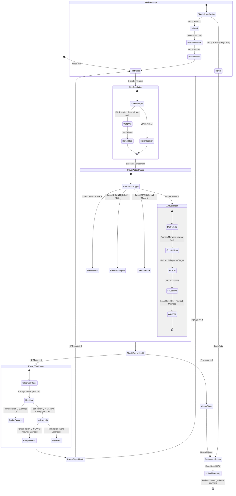

# Technical Specification Document (TSD)
**Penelitian**: Komparasi Efektivitas Monetisasi Rewarded Ads dan In-App Purchase (Premium Cosmetics) pada Desain Game Hybrid-Casual Berdasarkan Analisis ARPU  
**Game**: *Lucky Duelist: Cyber Roulette (1v1 Hybrid-Casual RNG Slot with Action Timing)*  
**Target Engine**: Unity (C#)  
**Peneliti**: Hafiz Ahmad Fauzi / 5224600067  

---

## 1. Arsitektur Perangkat Lunak & Aliran Sistem

Sistem game dirancang modular dengan pemisahan tegas antara logika permainan (*Gameplay Core*), sistem eksperimen A/B (*Experiment Controller*), modul monetisasi (*Monetization Layer*), serta layanan telemetri cloud (*Telemetry Service*).

```
┌────────────────────────────────────────────────────────────────────────────┐
│                         UNITY CLIENT LAYER (UI/UX)                         │
│  ┌───────────────────────┐  ┌─────────────────────┐  ┌──────────────────┐  │
│  │   Aim Stabilizer UI   │  │   Defense QTE UI    │  │ Virtual Store UI │  │
│  │ (Outer Box + Circles) │  │ (Red/Yellow Lights) │  │(Gun & Knife Skin)│  │
│  └───────────▲───────────┘  └──────────▲──────────┘  └────────▲─────────┘  │
└──────────────┼─────────────────────────┼──────────────────────┼────────────┘
               │                         │                      │
┌──────────────┴─────────────────────────┴──────────────────────┴────────────┐
│                        CORE APPLICATION MANAGERS                           │
│  ┌───────────────────────┐  ┌───────────────────────┐  ┌────────────────┐  │
│  │      GameManager      │  │   ExperimentManager   │  │  DummyAdPlayer │  │
│  │ (Master State Machine)│  │ (A/B Feature-Gating)  │  │(Countdown 10s) │  │
│  └───────────▲───────────┘  └──────────▲────────────┘  └────────▲───────┘  │
│              │                         │                        │          │
│  ┌───────────▼─────────────────────────┴────────────────────────▼────────┐ │
│  │                            CombatManager                              │ │
│  │  - SlotMachineEngine (5 Simbol: Attack, Mark, Heal, Sharpen, Wild)    │ │
│  │  - AimStabilizerController (Perlin Drift & 1s Lock-On Auto-Fire)      │ │
│  │  - DefenseQTEController (Q: Dodge Red Light / E: Parry Yellow Light)  │ │
│  │  - BotAIController (Stage 1 Rookie -> Stage 2 Gambler -> Stage 3 Boss)│ │
│  └─────────────────────────────────────▲─────────────────────────────────┘ │
└────────────────────────────────────────┼───────────────────────────────────┘
                                         │
┌────────────────────────────────────────┴───────────────────────────────────┐
│                    TELEMETRY & NETWORKING LAYER                            │
│  ┌──────────────────────────────────────────────────────────────────────┐  │
│  │                  TelemetryService (UnityWebRequest)                  │  │
│  │  - Serialisasi JSON (Session, Ad Impressions, IAP, Combat Stats)     │  │
│  │  - Fallback Lokal: Application.persistentDataPath/pending_logs.json  │  │
│  └─────────────────────────────────────┬────────────────────────────────┘  │
└────────────────────────────────────────┼───────────────────────────────────┘
                                         ▼
┌────────────────────────────────────────────────────────────────────────────┐
│           CLOUD BACKEND (Firebase Firestore / Supabase REST API)           │
└────────────────────────────────────────────────────────────────────────────┘
```

---

## 2. Rincian Modul & Kelas Perangkat Lunak

### 2.1. `GameManager` (Master State Controller)
* **Tanggung Jawab**: Mengatur transisi status global permainan dari inisialisasi hingga pengalihan kuesioner akhir.
* **State Enumeration**:
  ```csharp
  public enum GameState {
      SPLASH_INIT,           // Memuat/menghasilkan UserID, menetapkan group A/B/C
      LOBBY_STORE,           // Menu awal & akses etalase skin (jika Group B/C)
      MATCH_START,           // Inisialisasi bot (Stage 1, 2, atau 3)
      PLAYER_SLOT_TURN,      // Pemain memutar mesin slot 3-reel & alokasi hold
      PLAYER_AIM_PHASE,      // Mini-game Aim Stabilizer (eksekusi Attack)
      ENEMY_ATTACK_QTE_PHASE,// Mini-game Hindar (Q) & Parry Pisau (E)
      MATCH_SETTLEMENT,      // Layar menang/kalah (Tawaran Revive / Double Gold)
      SESSION_COMPLETE       // Unggah telemetri & redirect ke URL Google Form
  }
  ```

---

### 2.2. `ExperimentManager` (Pengontrol A/B Testing & Feature Flags)
* **Tanggung Jawab**: Memisahkan perlakuan antar-responden secara otomatis (1:1:1 balancing) dengan dukungan *Secret Override* bagi peneliti.
* **Logika Feature Flagging**:
  | Fitur | Group A (Dominan Ads) | Group B (Dominan IAP) | Group C (Hybrid Seimbang) |
  |---|---|---|---|
  | Re-spin Slot Reel via Ad | **TRUE** | **FALSE** (Tombol disembunyikan) | **TRUE** |
  | Revive HP via Ad | **TRUE** | **FALSE** (Langsung Game Over) | **TRUE** |
  | 2x Gold Multiplier via Ad | **TRUE** | **FALSE** (Klaim Normal) | **TRUE** |
  | Akses Toko Skin Kosmetik | **FALSE** (Menu disembunyikan) | **TRUE** | **TRUE** |
  | Saldo Uang Virtual | Rp 0 | Rp 20.000 | Rp 20.000 |

* **Proctor Secret Menu**: Mengetuk logo game di pojok kiri atas sebanyak 5 kali membuka panel tersembunyi untuk mengganti `user_id` atau `group_id` secara manual saat pendampingan responden di laboratorium.

---

### 2.3. `SlotMachineEngine` (Logika 5 Simbol & Hold Slots)
* **Tanggung Jawab**: Mengundi hasil 3 reel berdasarkan tabel probabilitas acak dan mengelola 2 kotak penyimpanan (*Hold Inventory*).
* **Tabel Probabilitas**:
  ```csharp
  public enum SlotSymbol {
      ATTACK,           // 35% Bobot
      MARK,             // 20% Bobot
      HEAL,             // 20% Bobot
      COUNTER_SHARPEN,  // 15% Bobot
      WILD_JOKER        // 10% Bobot
  }
  ```
* **Mekanisme Putaran**:
  1. *Roll Execution*: Mengacak 3 simbol reel.
  2. *Re-spin Single Reel*: Jika di Group A atau C, pemain dapat menonton video iklan simulasi (10s) untuk mengacak ulang 1 reel tertentu (maksimal 1x per turn).
  3. *Hold Allocation*: Pemain dapat memindahkan 0 s/d 2 simbol ke *Hold Slots*. Minimal 1 simbol wajib berada di slot aktif untuk dieksekusi.
  4. *Wild Selection*: Jika muncul `WILD_JOKER`, UI memunculkan pilihan modal untuk memilih kartu apa pun sesuai kehendak pemain.

---

### 2.4. `AimStabilizerController` (Mini-Game Bidikan & Auto-Fire)
* **Tanggung Jawab**: Mengatur pergerakan *reticle*, mendeteksi gaya *counter-drag*, menghitung durasi *Lock-On*, dan melepaskan tembakan otomatis.
* **Algoritma Kontrol**:
  1. **Drift Liar Reticle**:
     Posisi reticle dipengaruhi oleh vektor kecepatan acak berbasis *Perlin Noise*:
     $$\vec{v}_{\text{drift}} = \text{Vector2}\big(\text{Mathf.PerlinNoise}(t, 0) - 0.5f, \; \text{Mathf.PerlinNoise}(0, t) - 0.5f\big) \times \text{Speed}$$
  2. **Gaya Penyeimbang Pemain (*Counter-Drag Force*)**:
     Input sentuhan/mouse yang diseret ke arah berlawanan menghasilkan vektor penyeimbang:
     $$\vec{v}_{\text{total}} = \vec{v}_{\text{drift}} + \vec{v}_{\text{counter\_drag}}$$
  3. **Deteksi Lingkaran Vital & Meter Lock-On**:
     * Jika jarak reticle terhadap pusat lingkaran vital $\le R_{\text{circle}}$:
       $$\text{lockOnTimer} += \Delta t$$
     * Jika reticle keluar dari lingkaran:
       $$\text{lockOnTimer} = \max(0, \; \text{lockOnTimer} - 0.5f \times \Delta t)$$
  4. **Eksekusi Tembakan Otomatis (1.0 Detik Penuh)**:
     * Ketika $\text{lockOnTimer} \ge 1.0\text{s}$, senjata meletus secara otomatis:
       * Jika musuh memiliki status `[MARK]`: Menghasilkan $2 \times \text{Base Damage}$ (30 DMG).
       * Status normal: Menghasilkan 15 DMG.
     * Jika pemain memiliki kombo beruntun (misal 2x atau 3x Attack), sistem langsung mereset meter ke 0 dan mengizinkan pengisian *lock-on* berikutnya secara beruntun.

---

### 2.5. `DefenseQTEController` (Sistem Hindar & Tangkis Pisau)
* **Tanggung Jawab**: Mengelola urutan serangan musuh, telegraf visual cahaya merah/kuning, serta deteksi penekanan tombol **"Q"** dan **"E"**.
* **Urutan Waktu Serangan Musuh**:
  ```mermaid
  sequenceDiagram
      autonumber
      participant Bot as Musuh (AI)
      participant UI as Efek Cahaya Telegraf
      participant Player as Input Pemain (Q / E)
      participant Combat as CombatManager

      Bot->>UI: Mulai Ayunan Serangan
      alt Ada Buff COUNTER/SHARPEN
          UI->>Player: Mainkan Audio Cue Warning (Ding!)
      end
      UI->>UI: Fade-in Cahaya Transparan -> Cahaya Merah (0.0s - 0.6s)
      alt Pemain Tekan "Q" (Hindar)
          Player->>Combat: Input DODGE Diterima
          Combat->>Bot: Animasi Roll Samping -> Damage = 0
      else Pemain Belum Tekan
          UI->>UI: Kilatan Cahaya Kuning (0.6s - 0.9s Tepat Sebelum Kena)
          alt Pemain Tekan "E" (Parry Pisau)
              Player->>Combat: Input PARRY Diterima
              Combat->>UI: SFX 'CLANG!' + Kilatan Lentingan Logam
              Combat->>Bot: Tangkis Sukses! Deflection Riposte (35-45 Damage ke Bot)
          else Tidak Menekan / Terlambat
              Combat->>Player: Serangan Mendarat Penuh (-25 HP Pemain)
          end
      end
  ```

---

### 2.6. `MonetizationManager`
* **Sub-komponen `DummyAdPlayer`**:
  * Menampilkan kanvas overlay video tiruan fullscreen berdurasi **10 detik**.
  * Dilengkapi hitungan mundur dan tombol penutup (X) yang hanya aktif setelah 10 detik.
  * Menghasilkan nilai kontribusi iklan terstandarisasi:
    $$\text{Ad Impression Revenue} = \text{Rp } 250,00$$
* **Sub-komponen `VirtualIAPStore`**:
  * Mengelola saldo kuota eksperimen sebesar **Rp 20.000,00**.
  * Menyimpan status kepemilikan katalog kosmetik:
    * `SKIN_GUN` (Pistol Laser / Golden Revolver).
    * `SKIN_KNIFE` (Cyber Damascus Blade / Viper Knife).
    * `SKIN_AVATAR` (Neon Ronin / Syndicate Enforcer).
    * `SKIN_SLOT_THEME` (Retro 1984 / Vegas Deluxe).
  * Menghubungkan aset sprite visual dan audio melalui modul `CosmeticApplier`.

---

### 2.7. `TelemetryService` (Perekam & Sinkronisasi Cloud)
* **Tanggung Jawab**: Merekam setiap interaksi pertarungan, impresi iklan, dan transaksi belanja ke dalam objek data memori, lalu mengirimkannya melalui `UnityWebRequest` (HTTP POST) ke REST API Firebase Firestore atau Supabase.
* **Mekanisme Ketahanan Jaringan (Resilience)**:
  * Jika koneksi internet terputus, data disimpan ke media penyimpanan lokal perangkat:
    `Application.persistentDataPath + "/telemetry_backup.json"`.
  * Saat aplikasi mendeteksi koneksi pulih, data dikirim ulang (*retry synchronization*).

---

## 3. Diagram Alir State Pertarungan Lengkap



---

## 4. Keamanan & Integritas Metrik Penelitian

1. **Deterministic eCPM**: Setiap impresi iklan Rewarded Ad dihitung konstan sebesar Rp 250,00 sehingga nilai $ARPU_{Ads}$ murni mencerminkan perilaku dan keputusan pemain dalam memanfaatkan fitur penayangan iklan.
2. **Fixed Virtual Budget**: Alokasi saldo Rp 20.000,00 per responden pada Group B dan C memastikan pengukuran *Willingness to Pay* (WTP) terhadap skin kosmetik terstandarisasi antar-peserta.
3. **Pemisahan Log Refleks**: Metrik keberhasilan Parry dan Dodge dicatat secara terpisah dari metrik ekonomi agar peneliti dapat menganalisis korelasi antara tingkat keterampilan pemain (*skill level*) terhadap frekuensi penggunaan fitur monetisasi (misal: apakah pemain yang sering gagal parry lebih sering menggunakan *Revive Ads*).
